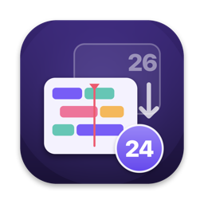
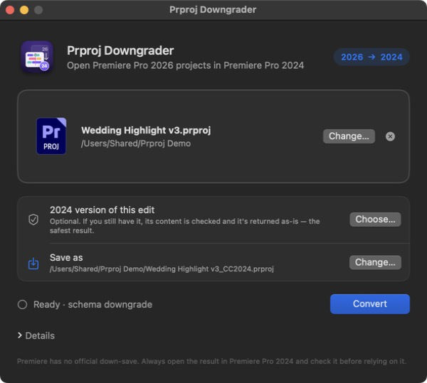

<p align="center">
  
</p>

<h1 align="center">Prproj Downgrader</h1>

<p align="center">
  Open Premiere Pro <b>2026</b> projects in Premiere Pro <b>2024</b>.<br>
  A macOS app and CLI that down-saves a <code>.prproj</code> from project schema v45 to v42.
</p>

<p align="center">
  <a href="https://github.com/xorica27/prproj-downgrader/actions/workflows/test.yml"></a>
  
  
  <a href="LICENSE"></a>
</p>

<p align="center">
  
</p>

Premiere has no built-in down-save. This tool rebuilds the 2024 schema from the
2026 object graph. It is a best-effort transform: your original is never
modified, and you should open the result in Premiere 2024 and check it before
using it for real work.

> Not affiliated with Adobe. Premiere Pro is a trademark of Adobe Inc.
> This repository contains no project files, media, or personal data.

---

## Download

1. Grab `PrprojDowngrader-<version>.zip` from
   [Releases](https://github.com/xorica27/prproj-downgrader/releases) and unzip it.
2. Move **PrprojDowngrader.app** to Applications.
3. First launch: the app is not notarised by Apple, so **right-click → Open**,
   then **Open** again. (Or: System Settings → Privacy & Security → Open Anyway.)

Runs on macOS 13 or newer, on Apple Silicon and Intel. Python is built in;
nothing else needs installing.

**Use it:** drop a `.prproj` on the window (or on the Dock icon, or use
Finder → Open With), press **Convert**, then **Show in Finder**. The result is
saved next to the original as `<name>_CC2024.prproj`.

---

## Two ways to downgrade

| Mode | When to use | What you get |
|---|---|---|
| **Reference transplant** (safest) | You still have a Premiere 2024 `.prproj` of the same edit | The 2024-native file, byte-for-byte. The tool first verifies sequences, clip IDs/names, edit points, durations and media paths match. |
| **Schema downgrade** | You only have the 2026 project | A rebuilt v42 project. Structurally validated, but always test it in Premiere 2024. |

If a 2024 reference is supplied, the app uses it automatically and refuses if
the editorial content differs.

---

## Build from source

Requirements: macOS 13+, Xcode command-line tools (`swiftc`, `lipo`), Python 3.9+
for the tests and CLI.

```bash
make app          # universal app/PrprojDowngrader.app
open app/PrprojDowngrader.app
make release      # -> dist/PrprojDowngrader-<version>.zip
```

`make app` downloads a pinned, SHA-256-verified standalone CPython 3.12 for
arm64 and x86_64 from
[python-build-standalone](https://github.com/astral-sh/python-build-standalone),
trims it, merges both into one universal runtime (cached in `build/`), and
bundles it in `Contents/Resources/python` with the converter and schema profile.
The app runs only that bundled runtime, never a system `python3`.

---

## CLI

```bash
python3 app/prproj_downgrade.py INPUT.prproj OUTPUT.prproj [options]
```

Requires Python 3.9+ (standard library only). Options:

```
--reference PATH   2024 .prproj of the same edit (content-matched transplant)
--schema PATH      schema profile (default: schema42.json next to the script)
--report PATH      write a JSON conversion report
--no-pretty        skip XML indentation (smaller/faster output)
--no-verify        skip the post-write XML well-formedness check
--quiet            only print errors
--version          print the engine version
```

Examples:

```bash
# safest path
python3 app/prproj_downgrade.py INPUT.prproj OUTPUT.prproj \
    --reference REFERENCE_2024.prproj --report report.json

# schema conversion only
python3 app/prproj_downgrade.py INPUT.prproj OUTPUT.prproj \
    --schema app/schema42.json --report report.json
```

The CLI refuses to overwrite the input or the reference. Exit codes:
`0` success, `2` bad arguments or unreadable input, `3` reference mismatch,
`4` verification failure.

---

## What the converter changes

Derived by comparing the same project saved by Premiere **24.1.x** (v42) and
**26.0.x** (v45):

- Project `Version` 45 → 42 and **27 of 64 object classes** reverted, including
  `Media` 30→27, `VideoStream` 22→19, `Sequence` 12→11, `MasterClip` 12→11,
  `ClipLoggingInfo` 10→8, track items, and every effect-parameter class 10→9.
- Inner element versions: `Track` 4→3, `TrackItem` 4→3, `AudioTrack` 12→11,
  `Component` 7→6.
- Restores fields 2026 stopped writing:
  - track `IsLocked`, `IsMuted`, `IsSyncLocked`
  - audio track `ChannelType`, `FrameRate`, `AutomationMode`, `SubType`,
    `Assign`, `Solo`, `MutedBySolo`, and `RecordChannel`
  - component `Bypass`, `Intrinsic`, `ArchivedType`
  - parameter `IsTimeVarying`, `ParameterControlType`, boolean bounds
  - `WorkingColorSpace` and `WorkingColorSpaceConfiguration`
  - project audio/video default settings
- Removes 2026-only data: `ColorAwareEffectsEnabled`, `OriginalColorSpace`,
  `OutputColorSpace` (converted), `ToneMapSettings`, `SideNav.*`,
  `WorkspaceDefinition`, `WorkspaceName`, `NextID`, track-level `ComponentOwner`,
  and 2026-only UI properties.
- Reorders restored fields into the 24.1 serialization order.

The schema profile in `app/schema42.json` contains only Adobe class/parameter
names and canonical field order. It has no project-specific identifiers.

---

## Validation

Validated against a real paired project saved by Premiere 24.1 (v42) and 26.0
(v45):

- 1,179 / 1,179 object UIDs identical; 41 / 41 sequences with identical names.
- All 63 shared object classes produced with matching versions.
- `ClipID`, `ClipName`, `DisplayName`, `Duration`, `InPoint`, `OutPoint`,
  `OriginalDuration` and all keyframes identical.
- Per-class schema paths matched for 60 of 63 classes; the remaining three are
  preview-cache and panel-state fields only.

Editorial content is preserved. The output is not byte-identical to a 24.1 save:
it keeps the 2026 project's object IDs and some UI state.

Run the tests with:

```bash
make test           # with your python3
make test-bundled   # with the runtime that ships inside the app
```

The test suite builds a tiny synthetic v45 project and checks every transform.
No real project data is included.

---

## Limitations

- **Test in Premiere 2024 before relying on the result.** The schema profile is
  derived from a real 24.1 file, but Premiere's parser is the final judge.
- Premiere 2024 must be **24.1 or newer** (the schema v42 writer).
- Preview-cache objects (`AudioPreviewItem`, `PreviewItem`) are not recreated;
  Premiere regenerates previews.
- 2026-only effects or parameters not covered by the schema profile fall back to
  generic defaults and are listed in the report's `warnings`.
- Audio frame rate is inferred from the project's own audio streams. Video
  project-default settings fall back to the 24.1 defaults (720×480, 29.97) when
  the project no longer stores them.
- The output keeps the 2026 project's object IDs and some harmless UI state.
- Undo history and preview caches are not migrated.

---

## Repository layout

```
app/
  prproj_downgrade.py       # Python engine + CLI
  PrprojDowngrader.swift    # SwiftUI macOS app
  build_app.sh              # builds the universal PrprojDowngrader.app
  schema42.json             # 24.1 field order + parameter-type profile
  AppIcon.icns              # app icon
scripts/
  fetch_python.sh           # pinned universal Python runtime for the app
  build_release.sh          # zipped .app release
  make_icon.swift           # regenerates AppIcon.icns
tests/
  test_downgrade.py         # synthetic-project unit tests
docs/                       # README images
Makefile
```

Regenerate the icon with `make icon` (requires `swift` and `iconutil`).

No `.prproj`, media, XML fixtures, reports, or personal paths are tracked.
`make release`, the built `.app` and `build/` are ignored by Git.

---

## License

[MIT](LICENSE)
